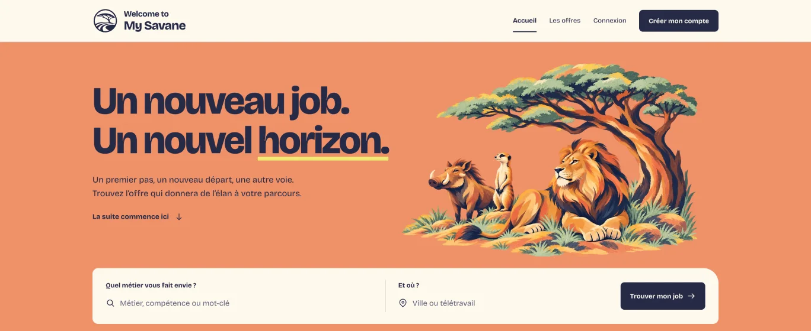
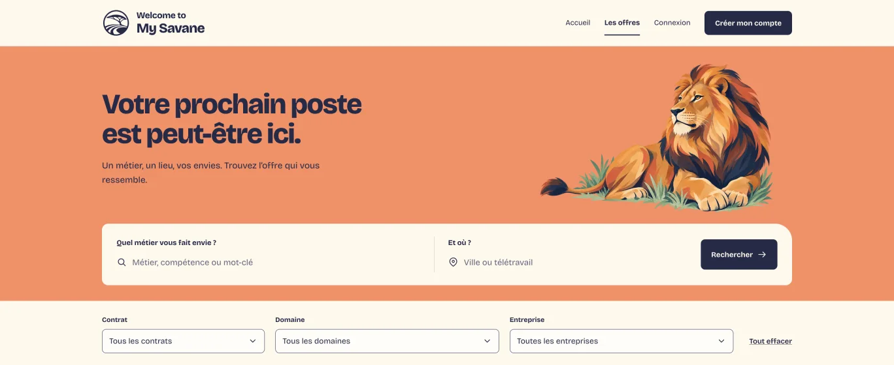
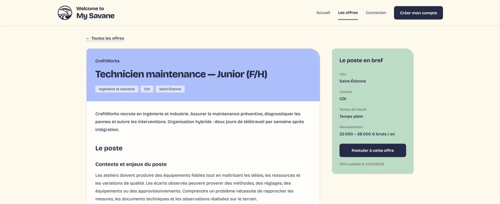
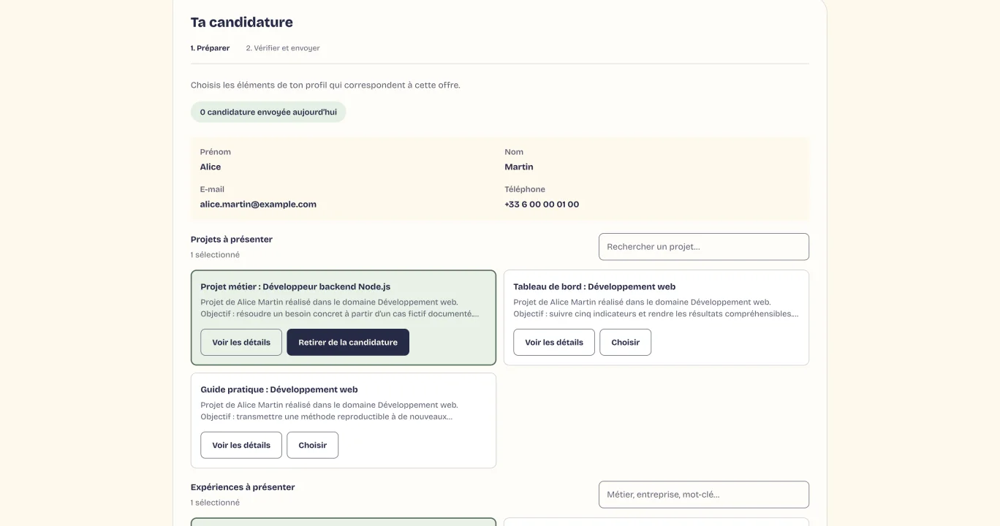
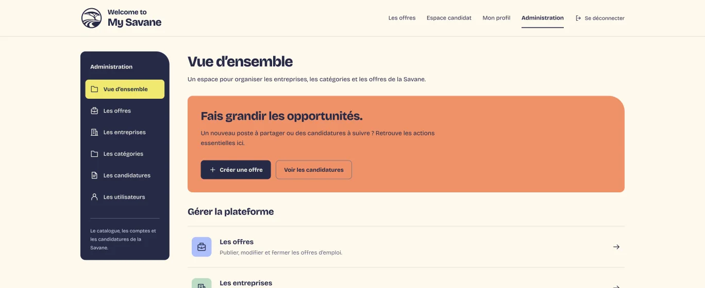
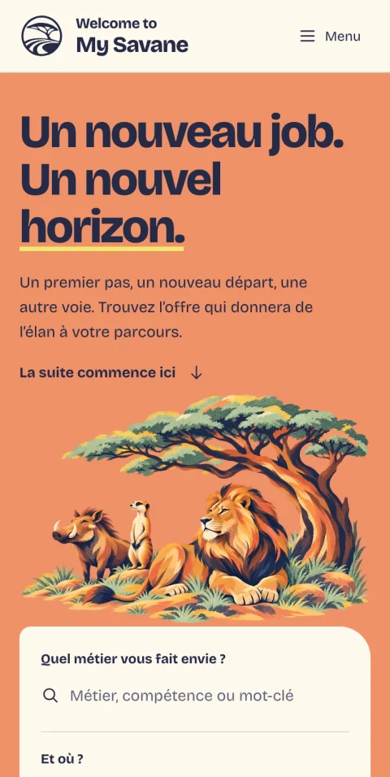

# Welcome to My Savane

<p align="center">
  
</p>

<p align="center">
  <strong>Un nouveau job. Un nouvel horizon.</strong><br>
  Un job board en français pour découvrir des offres et préparer sa candidature.
</p>

<p align="center">
  
  
  
  
  
</p>

> **Projet pédagogique Epitech T-WEB-501**, réalisé en équipe et encore en développement. Les entreprises, les offres et les comptes fournis pour la démonstration sont fictifs. N’y enregistrez pas de données personnelles réelles.

## Le projet

Welcome to My Savane rassemble des offres d’emploi et les outils pour préparer une candidature. Un candidat peut rechercher une opportunité, réunir ses projets et expériences dans son profil, choisir les éléments qu’il souhaite présenter et suivre ses candidatures.

## L’application en images

Voici six aperçus de l’application sur ordinateur et sur mobile. Cliquez sur une image pour ouvrir la capture complète.

<table>
  <tr>
    <td width="50%" valign="top">
      <a href="docs/assets/readme/01-accueil-desktop.png"></a>
      <p><strong>Accueil</strong><br>La page de départ et son moteur de recherche.</p>
    </td>
    <td width="50%" valign="top">
      <a href="docs/assets/readme/02-offres-filtrees-desktop.png"></a>
      <p><strong>Explorer les offres</strong><br>Parcourir les annonces et affiner la recherche.</p>
    </td>
  </tr>
  <tr>
    <td width="50%" valign="top">
      <a href="docs/assets/readme/03-detail-offre-desktop.png"></a>
      <p><strong>Détail d’une offre</strong><br>Consulter le poste, l’entreprise et les conditions.</p>
    </td>
    <td width="50%" valign="top">
      <a href="docs/assets/readme/04-candidature-recap-desktop.png"></a>
      <p><strong>Préparer une candidature</strong><br>Choisir les projets et expériences à joindre au dossier.</p>
    </td>
  </tr>
  <tr>
    <td width="50%" valign="top">
      <a href="docs/assets/readme/05-administration-desktop.png"></a>
      <p><strong>Administration</strong><br>Gérer les offres, entreprises, catégories et candidatures.</p>
    </td>
    <td width="50%" valign="top">
      <a href="docs/assets/readme/06-accueil-mobile.png"></a>
      <p><strong>Version mobile</strong><br>La page d’accueil s’adapte aussi aux téléphones.</p>
    </td>
  </tr>
</table>

L’illustration ci-dessous est également utilisée sur la page d’accueil. **C’est une illustration, pas une capture d’écran.**

<p align="center">
  
</p>

## Ce que l’application permet de faire

### Côté candidat

- Parcourir les offres, les rechercher par métier ou ville, appliquer des filtres et les enregistrer en favoris.
- Ouvrir une offre pour consulter sa description, son entreprise, son contrat et sa rémunération lorsqu’elle est renseignée.
- Créer un compte et compléter son profil avec des projets, des expériences et plusieurs CV PDF.
- Préparer une candidature en choisissant le CV, les projets et les expériences à joindre, puis relire le récapitulatif avant l’envoi.
- Retrouver ses candidatures et consulter leur statut.
- Choisir si son profil peut être visible dans l’annuaire recruteur.

### Côté recruteur et administration

- L’espace recruteur permet de gérer les offres et candidatures d’une entreprise, de consulter les profils rendus visibles et de gérer les comptes de son équipe.
- L’espace d’administration permet de gérer les offres, les entreprises, les catégories, les comptes et les candidatures. Un administrateur attribue les accès recruteur.

La documentation de l’API est disponible sur [Swagger](http://localhost:3000/api-docs) une fois le projet lancé.

## Installation pas à pas

La méthode recommandée utilise Docker Desktop. Elle lance le site, l’API et la base de données sans avoir à installer Node.js ou PostgreSQL séparément.

### 1. Installer Docker Desktop

Téléchargez et installez [Docker Desktop](https://docs.docker.com/desktop/), adapté à votre ordinateur. Ouvrez-le et attendez que Docker indique qu’il est démarré. Docker Desktop fournit Docker Compose, l’outil qui démarre ensemble les différents services du projet.

### 2. Récupérer le projet

Vous pouvez télécharger le dépôt depuis [GitHub](https://github.com/EpitechMscProPromo2029/T-WEB-501-PAR-5-1-job_board-6) avec **Code → Download ZIP**, puis extraire l’archive.

Après extraction, ouvrez un terminal dans le dossier du projet : sur Windows, faites un clic droit dans le dossier extrait puis choisissez **Ouvrir dans le Terminal** ; sur macOS, ouvrez Terminal, tapez `cd ` (avec un espace), faites glisser le dossier extrait dans la fenêtre puis appuyez sur Entrée.

Ou, si Git est déjà installé, ouvrez un terminal et exécutez :

```bash
git clone https://github.com/EpitechMscProPromo2029/T-WEB-501-PAR-5-1-job_board-6.git
cd T-WEB-501-PAR-5-1-job_board-6
```

Dans les étapes suivantes, les commandes doivent être exécutées **à la racine du dossier du projet**, celui qui contient `docker-compose.yml`.

### 3. Créer la configuration locale

Copiez le modèle de configuration dans un nouveau fichier `.env`.

**macOS ou Linux :**

```bash
cp .env.example .env
```

**Windows PowerShell :**

```powershell
Copy-Item .env.example .env
```

Ouvrez ensuite `.env` dans un éditeur de texte et remplacez la valeur de `SESSION_SECRET` par une chaîne privée aléatoire.

Pour en générer une :

**macOS ou Linux :**

```bash
openssl rand -hex 32
```

**Windows PowerShell 7 :**

```powershell
[Convert]::ToHexString([Security.Cryptography.RandomNumberGenerator]::GetBytes(32)).ToLower()
```

Copiez le résultat après `SESSION_SECRET=` dans `.env`. Ce fichier contient des paramètres locaux : ne partagez pas son contenu et ne l’ajoutez pas à Git. Les autres valeurs du fichier peuvent rester telles quelles pour un lancement local.

### 4. Démarrer l’application

Depuis la racine du projet, lancez :

```bash
docker compose up --build -d
```

Au premier lancement, Docker télécharge et construit les composants nécessaires ; cela peut prendre quelques minutes. Pour vérifier qu’ils ont démarré :

```bash
docker compose ps
```

Ouvrez ensuite ces adresses dans votre navigateur :

- **Site :** <http://localhost:5173>
- **API :** <http://localhost:3000>
- **Documentation API :** <http://localhost:3000/api-docs>

Au premier démarrage d’une base vide, des entreprises, offres, comptes et candidatures de démonstration sont ajoutés automatiquement.

### 5. Se connecter avec un compte de démonstration

| Profil | Adresse e-mail | Mot de passe |
| --- | --- | --- |
| Candidat | `alice.martin@example.com` | `JobBoardDemo2026!` |
| Administrateur | `admin@jobboard.example.com` | `JobBoardDemo2026!` |

Ces comptes sont créés par le seed lors de l’initialisation d’une base vide. Ils servent uniquement à la démonstration locale. Le seed ne fournit pas de compte recruteur : un administrateur doit attribuer cet accès depuis l’application.

## Arrêter ou relancer le projet

Pour afficher les journaux des services :

```bash
docker compose logs -f
```

Pour arrêter le site, l’API et PostgreSQL sans effacer les données locales :

```bash
docker compose down
```

Pour relancer les services plus tard, utilisez de nouveau `docker compose up -d` depuis la racine du projet.

> **Attention — réinitialisation de la base :** `docker compose down -v` supprime les données locales de la base et les CV stockés dans les volumes Docker. Ne lancez cette commande que si vous souhaitez vraiment repartir de zéro.

Les ports par défaut sont `5173` pour le site, `3000` pour l’API et `5433` pour PostgreSQL. Ils peuvent être modifiés dans `.env`.

## Technologies et versions

Les versions des bibliothèques JavaScript proviennent des fichiers `package-lock.json`. Les images Docker fixent Node.js à la branche 22 et PostgreSQL à la branche 17 ; ces tags ne fixent pas un numéro de correctif précis.

| Partie | Technologie | Version déclarée ou verrouillée |
| --- | --- | --- |
| Interface | React | 19.3.0 |
| Interface | React DOM | 19.3.0 |
| Navigation | React Router DOM | 7.18.4 |
| Outils frontend | Vite | 8.3.3 |
| Styles | Tailwind CSS | 4.3.3 |
| Serveur API | Node.js | 22 (`node:22-alpine` dans Docker) |
| Serveur API | Express | 5.2.1 |
| Sessions | express-session | 1.19.0 |
| Base de données | PostgreSQL | 17 (`postgres:17` dans Docker) |
| Connexion PostgreSQL | `pg` (node-postgres) | 8.23.1 |
| Hash des mots de passe | bcrypt | 6.0.0 |
| Dépôt de fichiers | Multer | 2.4.0 |
| Documentation API | Swagger UI Express | 5.0.1 |
| Orchestration locale | Docker Compose | V2 (fourni avec Docker Desktop ; non verrouillé par le projet) |

## Développement

Docker Compose est le moyen le plus simple de faire tourner l’ensemble du projet. Pour travailler sur le frontend séparément, installez Node.js 22, puis ouvrez un terminal dans `frontend/` :

```bash
npm ci
npm run dev
```

Commandes frontend disponibles :

```bash
npm run build   # construit le frontend pour la production
npm run lint    # vérifie le code avec ESLint
npm test        # lance les tests unitaires configurés
```

Le frontend seul ne démarre pas la base de données ni l’API. Pour essayer les parcours reliés aux données, démarrez les services avec Docker Compose depuis la racine du projet.

## Organisation du dépôt

```text
backend/   API Express, routes, contrôleurs et documentation Swagger
db/        Schéma PostgreSQL, seed de démonstration et migrations
docs/      Guides et documentation du projet
frontend/  Interface React, composants, pages et styles
```

Documentation complémentaire : [Guide CV](docs/GUIDE-CV.md) · [Documentation de l’espace administration](frontend/ADMIN.md) · [Laboratoire de design](docs/design-lab/README.md).

## Sécurité et données de démonstration

- Les données du seed sont fictives et utilisent des adresses `example.com`.
- Les CV envoyés localement sont stockés dans un volume Docker dédié et ne sont pas des données de démonstration.
- Les mots de passe sont stockés sous forme de hash bcrypt ; les routes protégées s’appuient sur une session.
- N’utilisez pas les comptes ou la configuration de démonstration en production.
